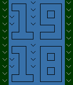
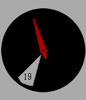

<!-- Generated by scripts/update_app_directory.py: do not edit by hand -->
[← All Pebble Developers](../developers.md)

# joravasal

*2 watchfaces · Last updated 2026-10-11 · [About these lists](../about-app-lists.md)*

Links: [Pebble App Store](https://apps.repebble.com/apps/dev/joravasal_54f9046252794e6bd900009b) · [GitHub (joravasal)](https://github.com/joravasal)

<button type="button" data-filter="all" aria-pressed="true">All 2</button><button type="button" data-filter="watchface" aria-pressed="false">Watchfaces 2</button><button type="button" data-filter="watchapp" aria-pressed="false" disabled>Apps 0</button>

<label class="dev-sort">Sort by <select><option value="updated">Recently updated</option><option value="released">Newest release</option><option value="title">A–Z</option></select></label>

<h2 class="app-name" id="app-56067556e3fed40eba000042"><a href="https://apps.repebble.com/56067556e3fed40eba000042">Spocks</a> v1.2</h2>
<a class="app-source" href="https://github.com/joravasal/SpocksWF" title="Source code" data-search-exclude>View source</a>

Watchface

Released 2015-09-26 Updated 2015-09-28

Runs on: Time 2, Pebble 2 Duo, Pebble 2, Time, Classic

Spocks (short for SPinning clOCKS, not related with the character from StarTrek, although I like to think he&#x27;d enjoy the watchface!) fills your Pebble screen with small analog watches that will…

<h2 class="app-name" id="app-555a16fbb038d475ea0000de"><a href="https://apps.repebble.com/555a16fbb038d475ea0000de">HourWindow</a> v1.4</h2>
<a class="app-source" href="https://github.com/joravasal/HourWindowWF" title="Source code" data-search-exclude>View source</a>

Watchface

Released 2015-05-18 Updated 2015-07-11

Runs on: Time 2, Pebble 2 Duo, Pebble 2, Time, Classic

A minimalistic analog watchface that will show only the actual hour and the minute hand. It can be fully customized, the options include: · Bluetooth status, it can be shown with an icon or by…

