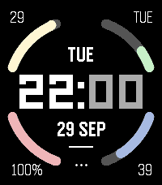
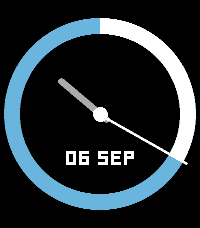
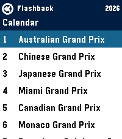
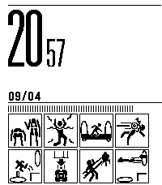

<!-- Generated by scripts/update_app_directory.py: do not edit by hand -->
[← All Pebble Developers](../developers.md)

# Jordan Fisher

*3 watchfaces and 1 app · Last updated 2026-10-12 · [About these lists](../about-app-lists.md)*

Links: [Pebble App Store](https://apps.repebble.com/apps/dev/jordan-fisher_5d482ff5d76b0f00018300f2) · [GitHub (thementalgoose)](https://github.com/thementalgoose) · [Website (flashback.pages.dev)](https://flashback.pages.dev)

<button type="button" data-filter="all" aria-pressed="true">All 4</button><button type="button" data-filter="watchface" aria-pressed="false">Watchfaces 3</button><button type="button" data-filter="watchapp" aria-pressed="false">Apps 1</button>

<label class="dev-sort">Sort by <select><option value="updated">Recently updated</option><option value="released">Newest release</option><option value="title">A–Z</option></select></label>

<h2 class="app-name" id="app-40d48d07d398413fbe331dc3"><a href="https://apps.repebble.com/40d48d07d398413fbe331dc3">ARCs</a> v2.3.0</h2>
<a class="app-source" href="https://github.com/thementalgoose/pebble-arcs" title="Source code" data-search-exclude>View source</a>

Watchface

Released 2026-04-12 Updated 2026-09-29

Runs on: Round 2, Time 2, Pebble 2 Duo, Pebble 2, Time Round, Time, Classic

Simple pebble watchface with indicator arcs in 4 corners of the display - Support for 12/24h times - Support for all watch types and sizes - Configurable colors for each indicators - Configurable…

<h2 class="app-name" id="app-dc3358b00af54f069f14d883"><a href="https://apps.repebble.com/dc3358b00af54f069f14d883">Halo Swipe</a> v1.0.0</h2>
<a class="app-source" href="https://github.com/thementalgoose/pebble-halo-swipe" title="Source code" data-search-exclude>View source</a>

Watchface

Released 2026-09-26 Updated 2026-09-26

Runs on: Round 2, Time 2, Pebble 2 Duo, Pebble 2, Time Round, Time, Classic

Simple watchface inspired by the watchface within the OG Kickstarter Pebble Time 2 video https://www.kickstarter.com/projects/getpebble/pebble-2-time-2-and-core-an-entirely-new-3g-ultra…

<h2 class="app-name" id="app-6929da3470731e00092debea"><a href="https://apps.repebble.com/6929da3470731e00092debea">Flashback F1 Results</a> v2.2.0</h2>
<a class="app-source" href="https://github.com/thementalgoose/pebble-flashback" title="Source code" data-search-exclude>View source</a>

App

Released 2025-11-28 Updated 2026-09-13

Runs on: Round 2, Time 2, Pebble 2 Duo, Pebble 2, Time Round, Time

Get info on the current F1 Formula 1 Season - Current calendar + weekend schedule in your local timezone - Timeline pins for each event per weekend - Drivers Standings - Team Standings

<h2 class="app-name" id="app-4e59818904134ba485cd636e"><a href="https://apps.repebble.com/4e59818904134ba485cd636e">Portal Test Chamber</a> v1.3</h2>
<a class="app-source" href="https://github.com/thementalgoose/pebble-testchamber" title="Source code" data-search-exclude>View source</a>

Watchface

Released 2026-04-09 Updated 2026-04-14

Runs on: Round 2, Time 2, Pebble 2 Duo, Pebble 2, Time Round, Time, Classic

A watchface, inspired by the Portal game test chambers that you are seen at the start of levels Inspired by https://apps.repebble.com/portal-sign_5832c17200355a8634000185, but supporting all watch…

