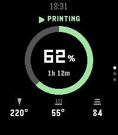

<!-- Generated by scripts/update_app_directory.py: do not edit by hand -->
[← All Pebble Developers](../developers.md)

# Jordan Storme

*1 app · Last updated 2026-10-12 · [About these lists](../about-app-lists.md)*

Links: [Pebble App Store](https://apps.repebble.com/apps/dev/jordan-storme_5e6455b63eb686623206c76f) · [GitHub (jordanfromeverywhere)](https://github.com/jordanfromeverywhere)

<h2 class="app-name" id="app-7e8fda844ba74051a0f32b71"><a href="https://apps.repebble.com/7e8fda844ba74051a0f32b71">PrintWrist</a> v1.1.0</h2>
<a class="app-source" href="https://github.com/jordanfromeverywhere/printwrist" title="Source code" data-search-exclude>View source</a>

App

Released 2026-09-25 Updated 2026-09-26

Runs on: Time 2

Your Bambu Lab printer, on your wrist, from anywhere. PrintWrist shows your print&#x27;s progress, time left, temperatures, fans, speed and AMS filament on your Pebble Time 2, over Bambu Cloud, so it…

