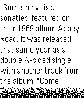

<!-- Generated by scripts/update_app_directory.py: do not edit by hand -->
[← All Pebble Developers](../developers.md)

# Jorge Izquierdo

*1 watchface · Last updated 2026-10-12 · [About these lists](../about-app-lists.md)*

Links: [Pebble App Store](https://apps.repebble.com/apps/dev/jorge-izquierdo_52c01cec101f1a76bc000045) · [GitHub (izqui)](https://github.com/izqui) · [Website (izqui.me)](http://izqui.me/twebble)

<h2 class="app-name" id="app-52cf0183bed07f7d3a000070"><a href="https://apps.repebble.com/52cf0183bed07f7d3a000070">Memoface</a> v1.0.0</h2>
<a class="app-source" href="https://github.com/izqui/Memoface" title="Source code" data-search-exclude>View source</a>

Watchface

No licence Released 2014-01-09 Updated 2014-01-09

Runs on: Time 2, Pebble 2 Duo, Pebble 2, Time, Classic

Memoface allows you to have a note in your watch face always you want, just in case you want to remember. It works with the accelerometer.

