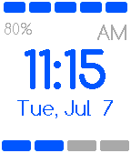

<!-- Generated by scripts/update_app_directory.py: do not edit by hand -->
[← All Pebble Developers](../developers.md)

# Jori Seidel

*1 watchface · Last updated 2026-10-12 · [About these lists](../about-app-lists.md)*

Links: [Pebble App Store](https://apps.repebble.com/apps/dev/jori-seidel_5307823ea7b6bad6fc000059) · [GitHub (Toverbal)](https://github.com/Toverbal)

<h2 class="app-name" id="app-559a583f393bdf0896000010"><a href="https://apps.repebble.com/559a583f393bdf0896000010">Easy Time</a> v1.2</h2>
<a class="app-source" href="https://github.com/Toverbal/EasyTime" title="Source code" data-search-exclude>View source</a>

Watchface

MIT Released 2015-07-06 Updated 2015-07-07

Runs on: Time 2, Pebble 2 Duo, Pebble 2, Time, Classic

Easy Time is a watchface that lets you read the time with ease! How often does someone ask you the time and you look at your precious Pebble Time and you see 11:17 and have say eeh, it&#x27;s 11:15!?…

