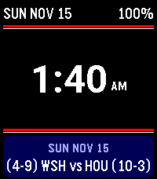

<!-- Generated by scripts/update_app_directory.py: do not edit by hand -->
[← All Pebble Developers](../developers.md)

# Joseph Contreras

*1 watchface · Last updated 2026-11-23 · [About these lists](../about-app-lists.md)*

Links: [Pebble App Store](https://apps.repebble.com/apps/dev/joseph-contreras_dc438f9166a89ef88cd154c1) · [GitHub (jcontreras29)](https://github.com/jcontreras29)

<h2 class="app-name" id="app-00faafab20254f978f82b623"><a href="https://apps.repebble.com/00faafab20254f978f82b623">NBA Watchface</a> v2.3.0</h2>
<a class="app-source" href="https://github.com/jcontreras29/pt2-basketball-watchface" title="Source code" data-search-exclude>View source</a>

Watchface

No licence Released 2026-11-15 Updated 2026-11-15

Runs on: Round 2, Time 2

A minimal watch face for all NBA enthusiasts!

