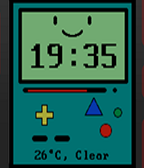

<!-- Generated by scripts/update_app_directory.py: do not edit by hand -->
[← All Pebble Developers](../developers.md)

# Joseph Reusing

*1 watchface · Last updated 2026-10-12 · [About these lists](../about-app-lists.md)*

Links: [Rebble App Store](https://apps.rebble.io/en_US/developer/576ee7526c2104ce5500002f/1) · [GitHub (joeyreu)](https://github.com/joeyreu) · [Website (joeyreu.github.io)](https://joeyreu.github.io/)

<h2 class="app-name" id="app-598c9662461a8d9e49000c1c"><a href="https://apps.rebble.io/en_US/application/598c9662461a8d9e49000c1c">BMO Adventure Time Watchface</a> v1.0</h2>
<a class="app-source" href="https://github.com/joeyreu/PebbleWatchFace" title="Source code" data-search-exclude>View source</a>

Watchface

No licence Released 2017-08-10 Updated 2017-08-10 Rebble App Store

Runs on: Round 2, Time 2, Pebble 2 Duo, Pebble 2, Time Round, Time, Classic

BMO Adventure Time Watch Face

