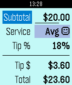

<!-- Generated by scripts/update_app_directory.py: do not edit by hand -->
[← All Pebble Developers](../developers.md)

# Joseph Roque

*1 app · Last updated 2026-10-12 · [About these lists](../about-app-lists.md)*

Links: [Pebble App Store](https://apps.repebble.com/apps/dev/joseph-roque_55a1365ba0b1b852fa00003e) · [GitHub (joseph-roque)](https://github.com/joseph-roque)

<h2 class="app-name" id="app-55ca3971688a90d0850000a9"><a href="https://apps.repebble.com/55ca3971688a90d0850000a9">TipCalc</a> v1.1</h2>
<a class="app-source" href="https://github.com/joseph-roque/tip-calc" title="Source code" data-search-exclude>View source</a>

App

Released 2015-08-11 Updated 2015-08-13

Runs on: Time 2, Pebble 2 Duo, Pebble 2, Time, Classic

Quickly calculate the tip on your bill based on the quality of service you feel you received! Between great, average, and poor service, the values you define are saved for when you come back so…

