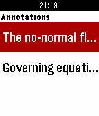

<!-- Generated by scripts/update_app_directory.py: do not edit by hand -->
[← All Pebble Developers](../developers.md)

# Josh Emerson

*1 app · Last updated 2026-10-12 · [About these lists](../about-app-lists.md)*

Links: [Pebble App Store](https://apps.repebble.com/apps/dev/josh-emerson_54f6d5ad077144f23d000026) · [GitHub (joshje)](https://github.com/joshje)

<h2 class="app-name" id="app-560ae6554bf0ac5620000001"><a href="https://apps.repebble.com/560ae6554bf0ac5620000001">Mendeley</a> v1.0</h2>
<a class="app-source" href="https://github.com/joshje/mendeley-pebble-app" title="Source code" data-search-exclude>View source</a>

App

Released 2015-09-29 Updated 2015-09-29

Runs on: Time 2, Pebble 2 Duo, Pebble 2, Time, Classic

Browse your Mendeley library on your Pebble! You can read the documents added via Mendeley, and see any annotations you&#x27;ve added. This is an unofficial app for Mendeley and is not affiliated with…

