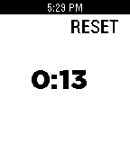

<!-- Generated by scripts/update_app_directory.py: do not edit by hand -->
[← All Pebble Developers](../developers.md)

# Josh Evans

*2 apps · Last updated 2026-10-11 · [About these lists](../about-app-lists.md)*

Links: [Pebble App Store](https://apps.repebble.com/apps/dev/josh-evans_52fba17f4c38ceaa1d000588) · [GitHub (jjv360)](https://github.com/jjv360) · [GitHub (lorenlugosch)](https://github.com/lorenlugosch)

<button type="button" data-filter="all" aria-pressed="true">All 2</button><button type="button" data-filter="watchface" aria-pressed="false" disabled>Watchfaces 0</button><button type="button" data-filter="watchapp" aria-pressed="false">Apps 2</button>

<label class="dev-sort">Sort by <select><option value="updated">Recently updated</option><option value="released">Newest release</option><option value="title">A–Z</option></select></label>

<h2 class="app-name" id="app-53a6d40ed5712479fc00018f"><a href="https://apps.repebble.com/53a6d40ed5712479fc00018f">Torrent helper</a> v1.0.0</h2>
<a class="app-source" href="https://github.com/jjv360/uTorrent-Pebble" title="Source code" data-search-exclude>View source</a>

App

Released 2014-06-22 Updated 2014-06-22

Runs on: Time 2, Pebble 2 Duo, Pebble 2, Time, Classic

Control your torrent client from your wrist !

<h2 class="app-name" id="app-53a705f969f1e6bd040001e4"><a href="https://apps.repebble.com/53a705f969f1e6bd040001e4">Pebble timer</a> v1.0</h2>
<a class="app-source" href="https://github.com/lorenlugosch/pebble_stopwatch" title="Source code" data-search-exclude>View source</a>

App

Released 2014-06-22 Updated 2014-06-22

Runs on: Time 2, Pebble 2 Duo, Pebble 2, Time, Classic

A simple stopwatch for your wrist

