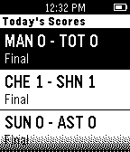

<!-- Generated by scripts/update_app_directory.py: do not edit by hand -->
[← All Pebble Developers](../developers.md)

# Josh Gerdes

*1 app · Last updated 2026-10-11 · [About these lists](../about-app-lists.md)*

Links: [Pebble App Store](https://apps.repebble.com/apps/dev/josh-gerdes_5498bfcb914326b1c9000027) · [GitHub (joshgerdes)](https://github.com/joshgerdes)

<h2 class="app-name" id="app-54a762910cd9361163000177"><a href="https://apps.repebble.com/54a762910cd9361163000177">Premier League Scores</a> v1.3</h2>
<a class="app-source" href="https://github.com/joshgerdes/pebblejs-epl" title="Source code" data-search-exclude>View source</a>

App

Released 2015-01-03 Updated 2015-02-03

Runs on: Time 2, Pebble 2 Duo, Pebble 2, Time, Classic

This is a pebble.js watchapp for displaying today&#x27;s English Premier League scores. Get up to the minute scores on the soccer/football matches happening today. Do you enjoy this app? Why help fund…

