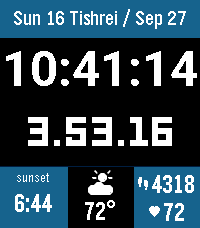

<!-- Generated by scripts/update_app_directory.py: do not edit by hand -->
[← All Pebble Developers](../developers.md)

# Josh Rosenberg

*1 watchface · Last updated 2026-10-11 · [About these lists](../about-app-lists.md)*

Links: [Pebble App Store](https://apps.repebble.com/apps/dev/josh-rosenberg_2bcc0a3741b25faf198da7b8) · [GitHub (rosenbergj)](https://github.com/rosenbergj)

<h2 class="app-name" id="app-9cc1f2cb2f78476f8bcbca70"><a href="https://apps.repebble.com/9cc1f2cb2f78476f8bcbca70">Shaot Zemaniot</a> v1.2.2</h2>
<a class="app-source" href="https://github.com/rosenbergj/pebble-shaot-zemaniot" title="Source code" data-search-exclude>View source</a>

Watchface

Released 2026-09-01 Updated 2026-09-30

Runs on: Time 2

A highly configurable watchface showing Shaot Zemaniot, an ancient Jewish form of timekeeping. Alongside the ordinary civil time, this watchface divides the daytime (sunrise to sunset, or sunset…

