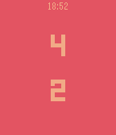
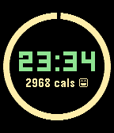

<!-- Generated by scripts/update_app_directory.py: do not edit by hand -->
[← All Pebble Developers](../developers.md)

# Josh

*1 watchface and 2 apps · Last updated 2026-10-12 · [About these lists](../about-app-lists.md)*

Links: [Pebble App Store](https://apps.repebble.com/apps/dev/josh_562aeeb815ecb9261c00001f) · [GitHub (nonproftechie)](https://github.com/nonproftechie)

<button type="button" data-filter="all" aria-pressed="true">All 3</button><button type="button" data-filter="watchface" aria-pressed="false">Watchfaces 1</button><button type="button" data-filter="watchapp" aria-pressed="false">Apps 2</button>

<label class="dev-sort">Sort by <select><option value="updated">Recently updated</option><option value="released">Newest release</option><option value="title">A–Z</option></select></label>

<h2 class="app-name" id="app-56dcd972042803d6fd00003d"><a href="https://apps.repebble.com/56dcd972042803d6fd00003d">Scorekeeper</a> v1.3</h2>
<a class="app-source" href="https://github.com/nonproftechie/scorekeeper" title="Source code" data-search-exclude>View source</a>

App

Released 2016-03-07 Updated 2016-03-21

Runs on: Round 2, Time 2, Pebble 2 Duo, Pebble 2, Time Round, Time, Classic

A simple scorekeeper for 2 teams. Pressing the top and bottom buttons changes the score for the upper and lower scores, respectively. Pressing the middle button toggles positive/negative scoring…

<h2 class="app-name" id="app-56ef7a44b07e3534cb000043"><a href="https://apps.repebble.com/56ef7a44b07e3534cb000043">Calorie Counter Beta</a> v1.0</h2>
<a class="app-source" href="https://github.com/nonproftechie/calorie-counter" title="Source code" data-search-exclude>View source</a>

Watchface

Released 2016-03-21 Updated 2016-03-21

Runs on: Round 2, Time 2, Time Round, Time

Digital face with your current progress towards today&#x27;s 3000-calorie goal.

<h2 class="app-name" id="app-567050ba2e7c0c788700003d"><a href="https://apps.repebble.com/567050ba2e7c0c788700003d">Roll</a> v1.0</h2>
<a class="app-source" href="https://github.com/nonproftechie/roll" title="Source code" data-search-exclude>View source</a>

App

Released 2015-12-15 Updated 2016-03-07

Runs on: Round 2, Time 2, Pebble 2 Duo, Pebble 2, Time Round, Time, Classic

Want to play a game that requires rolling a die, but you lost it? Have no fear, Roll app is near! Wiggle your Pebble or push one of the buttons to get your lucky number!

