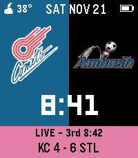

<!-- Generated by scripts/update_app_directory.py: do not edit by hand -->
[← All Pebble Developers](../developers.md)

# Joshakin

*1 watchface · Last updated 2026-11-23 · [About these lists](../about-app-lists.md)*

Links: [Pebble App Store](https://apps.repebble.com/apps/dev/joshakin_e8c421cbd3e2fc79066d6418) · [GitHub (Joshakin1)](https://github.com/Joshakin1)

<h2 class="app-name" id="app-5a81db53e3ec415793d6cc70"><a href="https://apps.repebble.com/5a81db53e3ec415793d6cc70">MASL Watchface</a> v1.1.0</h2>
<a class="app-source" href="https://github.com/Joshakin1/pebble-masl-watchface" title="Source code" data-search-exclude>View source</a>

Watchface

No licence Released 2026-11-17 Updated 2026-11-20

Runs on: Round 2, Time 2, Pebble 2 Duo, Pebble 2, Time Round, Time

A watchface for Major Arena Soccer League fans. Pick your team and its logo fills the face, with the next game underneath. Don&#x27;t pick a team to get the league&#x27;s next game, with both logos on a…

