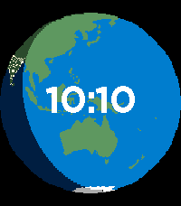

<!-- Generated by scripts/update_app_directory.py: do not edit by hand -->
[← All Pebble Developers](../developers.md)

# Joshua Simmons

*1 watchface · Last updated 2026-10-12 · [About these lists](../about-app-lists.md)*

Links: [Pebble App Store](https://apps.repebble.com/apps/dev/joshua-simmons_d00b3d7bfcc7c0ee8fcb2bf3) · [GitHub (simmonsja)](https://github.com/simmonsja)

<h2 class="app-name" id="app-20150c025d28421197fabfd0"><a href="https://apps.repebble.com/20150c025d28421197fabfd0">Hello, Pebble</a> v1.2</h2>
<a class="app-source" href="https://github.com/simmonsja/hello-pebble" title="Source code" data-search-exclude>View source</a>

Watchface

Released 2026-04-12 Updated 2026-05-12

Runs on: Round 2, Time 2, Time

A view of earth from space inspired by the blue marble and hello world images from Artemis and Apollo missions. Presents a fixed view of earth with a transition from day to night (approximate in…

