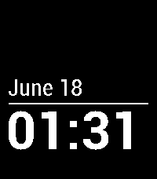

<!-- Generated by scripts/update_app_directory.py: do not edit by hand -->
[← All Pebble Developers](../developers.md)

# Joshua Wise

*3 watchfaces · Last updated 2026-10-12 · [About these lists](../about-app-lists.md)*

Links: [Rebble App Store](https://apps.rebble.io/en_US/developer/531aa3fb7e49755eab000f7b/1) · [Pebble App Store](https://apps.repebble.com/apps/dev/joshua-wise_531aa3fb7e49755eab000f7b) · [GitHub (jwise)](https://github.com/jwise) · [Website (joshuawise.com)](https://joshuawise.com/)

<button type="button" data-filter="all" aria-pressed="true">All 3</button><button type="button" data-filter="watchface" aria-pressed="false">Watchfaces 3</button><button type="button" data-filter="watchapp" aria-pressed="false" disabled>Apps 0</button>

<label class="dev-sort">Sort by <select><option value="updated">Recently updated</option><option value="released">Newest release</option><option value="title">A–Z</option></select></label>

<h2 class="app-name" id="app-6a3382f39d979d0009ccecd2"><a href="https://apps.rebble.io/en_US/application/6a3382f39d979d0009ccecd2">ReSimplicity</a> v4.0.0</h2>
<a class="app-source" href="https://github.com/jwise/resimplicity" title="Source code" data-search-exclude>View source</a>

Watchface · <a href="https://forum.rebble.io/t/1065" title="Discuss this app on the Rebble forum" data-search-exclude>Forum thread</a>

Released 2026-06-18 Updated 2026-06-18 Rebble App Store

Runs on: Round 2, Time 2, Pebble 2 Duo, Pebble 2, Time Round, Time, Classic

The classic built-in watchface for Pebble and Pebble Steel, now available for Pebble Time, Pebble Time Steel and Pebble Time Round, and with a native upscale for Core Time 2.

<h2 class="app-name" id="app-61751d9ff3f019000a8c1408"><a href="https://apps.rebble.io/en_US/application/61751d9ff3f019000a8c1408">Tunnel demo</a> v1.1</h2>
<a class="app-source" href="https://github.com/jwise/pebble-demo/" title="Source code" data-search-exclude>View source</a>

Watchface · <a href="https://forum.rebble.io/t/100" title="Discuss this app on the Rebble forum" data-search-exclude>Forum thread</a>

Released 2021-10-24 Updated 2025-12-04 Rebble App Store

Runs on: Time 2, Pebble 2 Duo, Pebble 2, Time, Classic

Perhaps this ought be a watchapp, but it is what it is, and anyway, I cannot be bothered to update it now! A simple demo effect.

<h2 class="app-name" id="app-531c39d3edcc18d065000167"><a href="https://apps.repebble.com/531c39d3edcc18d065000167">Dali Clock</a> v0.2</h2>
<a class="app-source" href="https://github.com/jwise/dalipebble" title="Source code" data-search-exclude>View source</a>

Watchface

Released 2014-03-09 Updated 2014-03-12

Runs on: Time 2, Pebble 2 Duo, Pebble 2, Time, Classic

Dali Clock displays a digital clock; when a digit changes, it &quot;melts&quot; into its new shape. Bring a dose of surrealism to your wrist with this port of jwz&#x27;s famous xdaliclock. (Animation looks much…

