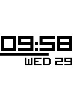

<!-- Generated by scripts/update_app_directory.py: do not edit by hand -->
[← All Pebble Developers](../developers.md)

# JoshuaJ0

*1 watchface · Last updated 2026-10-11 · [About these lists](../about-app-lists.md)*

Links: [Pebble App Store](https://apps.repebble.com/apps/dev/joshuaj0_52e91e56a85c63f6b1000034) · [GitHub (JoshuaJ0)](https://github.com/JoshuaJ0) · [Website (joshuajiang.me)](http://joshuajiang.me)

<h2 class="app-name" id="app-52e9cee25c062b090700003d"><a href="https://apps.repebble.com/52e9cee25c062b090700003d">Beam Up: Date, Inverted, 5 Second</a> v2.1.0</h2>
<a class="app-source" href="https://github.com/JoshuaJ0/Beam-Up-Date-Inverted-5-Seconds" title="Source code" data-search-exclude>View source</a>

Watchface

No licence Released 2014-01-30 Updated 2014-02-08

Runs on: Time 2, Pebble 2 Duo, Pebble 2, Time, Classic

The Beam Up watch face for the Pebble Smart Watch on SDK 2.0...with a twist! Has the date on the face, and it&#x27;s inverted (black numbers, white background). The progress bar also moves on 5 second…

