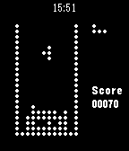

<!-- Generated by scripts/update_app_directory.py: do not edit by hand -->
[← All Pebble Developers](../developers.md)

# JP&\#x27;Studio

*1 app · Last updated 2026-10-11 · [About these lists](../about-app-lists.md)*

Links: [Pebble App Store](https://apps.repebble.com/apps/dev/jp-studio_52cb358b6e5f70cd64000085) · [GitHub (jpca)](https://github.com/jpca) · [Website (jppost.fr)](http://www.jppost.fr/jpstudio/jptris)

<h2 class="app-name" id="app-52ff8e23432d1c7d2200012c"><a href="https://apps.repebble.com/52ff8e23432d1c7d2200012c">JP&#x27;Tris</a> v1.0.0</h2>
<a class="app-source" href="https://github.com/jpca/pebble-jptris" title="Source code" data-search-exclude>View source</a>

App

Released 2014-02-15 Updated 2014-02-17

Runs on: Time 2, Pebble 2 Duo, Pebble 2, Time, Classic

This is a Tetris clone for pebble smart watch, with extra pieces if you exceed 300 points. Instructions : - up button : move left - down button : move right - middle button : rotate - have fun !!…

