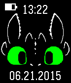

<!-- Generated by scripts/update_app_directory.py: do not edit by hand -->
[← All Pebble Developers](../developers.md)

# jpalazz2

*1 watchface · Last updated 2026-10-11 · [About these lists](../about-app-lists.md)*

Links: [Pebble App Store](https://apps.repebble.com/apps/dev/jpalazz2_52feae9f9afd98028300048a) · [GitHub (jpalazz2)](https://github.com/jpalazz2)

<h2 class="app-name" id="app-547f572e5557e73a6200003b"><a href="https://apps.repebble.com/547f572e5557e73a6200003b">Toothless Animated</a> v2.0</h2>
<a class="app-source" href="https://github.com/jpalazz2/toothless-animated" title="Source code" data-search-exclude>View source</a>

Watchface

Released 2014-12-03 Updated 2015-06-21

Runs on: Time 2, Pebble 2 Duo, Pebble 2, Time, Classic

An animated version of Toothless the dragon! Every minute Toothless blinks his eyes and looks around. Features battery level and Bluetooth status indicator.

