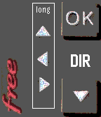

<!-- Generated by scripts/update_app_directory.py: do not edit by hand -->
[← All Pebble Developers](../developers.md)

# jpb31

*1 app · Last updated 2026-10-12 · [About these lists](../about-app-lists.md)*

Links: [Pebble App Store](https://apps.repebble.com/apps/dev/jpb31_571a16c9374e295d4f000012) · [GitHub (jpb31)](https://github.com/jpb31)

<h2 class="app-name" id="app-573462bdf68e7b0562000010"><a href="https://apps.repebble.com/573462bdf68e7b0562000010">Freebox Telec</a> v1.0</h2>
<a class="app-source" href="https://github.com/jpb31/PeebleFreeboxTelec" title="Source code" data-search-exclude>View source</a>

App

Released 2016-05-12 Updated 2016-08-29

Runs on: Time 2, Time

Remote for French Freebox Revolution player Télécommande Freebox Revolution 3 modes : Volume, Programme, et Pavé directionnel (SELECT pour permuter) Appuis long : Play/pause, Marche/Arrêt, Muet…

