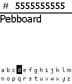
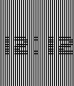
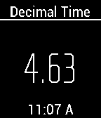

<!-- Generated by scripts/update_app_directory.py: do not edit by hand -->
[← All Pebble Developers](../developers.md)

# jpdesigns

*2 watchfaces and 1 app · Last updated 2026-10-11 · [About these lists](../about-app-lists.md)*

Links: [Pebble App Store](https://apps.repebble.com/apps/dev/jpdesigns_531a21865af660f5fd00034f) · [GitHub (dewguzzler)](https://github.com/dewguzzler) · [Website (dewguzzler.github.io)](http://dewguzzler.github.io/)

<button type="button" data-filter="all" aria-pressed="true">All 3</button><button type="button" data-filter="watchface" aria-pressed="false">Watchfaces 2</button><button type="button" data-filter="watchapp" aria-pressed="false">Apps 1</button>

<label class="dev-sort">Sort by <select><option value="updated">Recently updated</option><option value="released">Newest release</option><option value="title">A–Z</option></select></label>

<h2 class="app-name" id="app-54b81929cba63619cf000080"><a href="https://apps.repebble.com/54b81929cba63619cf000080">Pebboard</a> v1</h2>
<a class="app-source" href="https://github.com/dewguzzler/pebboard" title="Source code" data-search-exclude>View source</a>

App

Released 2015-01-15 Updated 2015-01-15

Runs on: Time 2, Pebble 2 Duo, Pebble 2, Time, Classic

**Must download companion app and open it at least once to actually send SMS** Using a custom made keyboard for Pebble, you can enter a phone number first and then a message. Long press select…

<h2 class="app-name" id="app-54b1e99fe0f7d98005000012"><a href="https://apps.repebble.com/54b1e99fe0f7d98005000012">Stitch in Time</a> v1.0</h2>
<a class="app-source" href="http://i.imgur.com/AAslJWe.gif" title="Source code" data-search-exclude>View source</a>

Watchface

Released 2015-01-11 Updated 2015-01-11

Runs on: Time 2, Pebble 2 Duo, Pebble 2, Time, Classic

The background has black and white vertical lines while the font for the clock is made of black and white horizontal lines. The intersection of the time and the background gives a sort of &quot;stitch&quot;…

<h2 class="app-name" id="app-54a2d4325c486f01df0000f0"><a href="https://apps.repebble.com/54a2d4325c486f01df0000f0">Decimal.Time</a> v1.0</h2>
<a class="app-source" href="https://github.com/dewguzzler/Decimal.time" title="Source code" data-search-exclude>View source</a>

Watchface

Released 2014-12-30 Updated 2014-12-30

Runs on: Time 2, Pebble 2 Duo, Pebble 2, Time, Classic

Used during the French Revolution, Decimal time has 10 hours in a day, 100 minutes in an hour, and 100 seconds per minute. Since decimal time has no practical use other than being an oddity, in…

