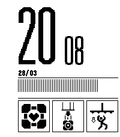
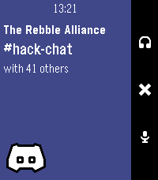

<!-- Generated by scripts/update_app_directory.py: do not edit by hand -->
[← All Pebble Developers](../developers.md)

# JPlexer

*1 watchface and 3 apps · Last updated 2026-10-12 · [About these lists](../about-app-lists.md)*

Links: [Pebble App Store](https://apps.repebble.com/apps/dev/jplexer_66d9e31d281f8a000981862f) · [Rebble App Store](https://apps.rebble.io/en_US/developer/66d9e31d281f8a000981862f/1) · [GitHub (jplexer)](https://github.com/jplexer) · [Website (funnyna.me)](https://funnyna.me)

<button type="button" data-filter="all" aria-pressed="true">All 4</button><button type="button" data-filter="watchface" aria-pressed="false">Watchfaces 1</button><button type="button" data-filter="watchapp" aria-pressed="false">Apps 3</button>

<label class="dev-sort">Sort by <select><option value="updated">Recently updated</option><option value="released">Newest release</option><option value="title">A–Z</option></select></label>

<h2 class="app-name" id="app-c03747b390094828979e6aa7"><a href="https://apps.repebble.com/c03747b390094828979e6aa7">BreakerBrick</a> v1.0.1</h2>
<a class="app-source" href="https://github.com/jplexer/breakerbrick" title="Source code" data-search-exclude>View source</a>

App

Released 2026-04-27 Updated 2026-05-01

Runs on: Round 2, Time 2

A breakout clone using touch and speaker

<h2 class="app-name" id="app-66efa9769c3343808eefed19"><a href="https://apps.repebble.com/66efa9769c3343808eefed19">Portal Sign (Alloy)</a> v1.0</h2>
<a class="app-source" href="https://github.com/jplexer/portal-sign-alloy" title="Source code" data-search-exclude>View source</a>

Watchface

Released 2026-03-28 Updated 2026-03-28

Runs on: Time 2

Rewrite of Portal Sign, written in Alloy for Pebble Time 2

<h2 class="app-name" id="app-66e9f326960bb300094251fc"><a href="https://apps.repebble.com/66e9f326960bb300094251fc">OpenMensa</a> v1.5</h2>
<a class="app-source" href="https://github.com/jplexer/OpenMensa" title="Source code" data-search-exclude>View source</a>

App

Released 2024-09-17 Updated 2025-11-24

Runs on: Round 2, Time 2, Pebble 2 Duo, Pebble 2, Time Round, Time, Classic

Your local Mensa, right on your Pebble! Compatible with any Mensa on https://openmensa.org

<h2 class="app-name" id="app-67cccea5b7a023024b214604"><a href="https://apps.rebble.io/en_US/application/67cccea5b7a023024b214604">Discord Companion</a> v2.0</h2>
<a class="app-source" href="https://github.com/jplexer/discord-companion" title="Source code" data-search-exclude>View source</a>

App

Released 2025-03-08 Updated 2025-03-28 Rebble App Store

Runs on: Round 2, Time 2, Pebble 2 Duo, Pebble 2, Time Round, Time, Classic

Requires https://github.com/jplexer/discord-companion running. This is basically a remote for your discord call! Mute, Deafen, whatever! Icons and Design by Lavender

