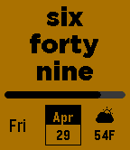

<!-- Generated by scripts/update_app_directory.py: do not edit by hand -->
[← All Pebble Developers](../developers.md)

# jpoles1

*1 watchface · Last updated 2026-10-11 · [About these lists](../about-app-lists.md)*

Links: [Pebble App Store](https://apps.repebble.com/apps/dev/jpoles1_5675a473d21898266b00003c) · [GitHub (jpoles1)](https://github.com/jpoles1) · [Website (jpoles1.github.io)](http://jpoles1.github.io)

<h2 class="app-name" id="app-56a27b5fd6753cffa800005d"><a href="https://apps.repebble.com/56a27b5fd6753cffa800005d">Elegant Text</a> v7.5</h2>
<a class="app-source" href="https://github.com/jpoles1/ElegantText" title="Source code" data-search-exclude>View source</a>

Watchface

Released 2016-01-22 Updated 2016-05-03

Runs on: Round 2, Time 2, Pebble 2 Duo, Pebble 2, Time Round, Time, Classic

A text-based watchface for Pebble Time with Weather and Bluetooth Disconnect notifications.

