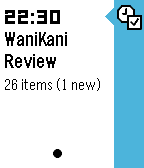

<!-- Generated by scripts/update_app_directory.py: do not edit by hand -->
[← All Pebble Developers](../developers.md)

# JR Mobley

*1 watchface and 1 app · Last updated 2026-10-12 · [About these lists](../about-app-lists.md)*

Links: [Pebble App Store](https://apps.repebble.com/apps/dev/jr-mobley_532746324735a9341d000142) · [GitHub (jrmobley)](https://github.com/jrmobley)

<button type="button" data-filter="all" aria-pressed="true">All 2</button><button type="button" data-filter="watchface" aria-pressed="false">Watchfaces 1</button><button type="button" data-filter="watchapp" aria-pressed="false">Apps 1</button>

<label class="dev-sort">Sort by <select><option value="updated">Recently updated</option><option value="released">Newest release</option><option value="title">A–Z</option></select></label>

<h2 class="app-name" id="app-5616d36a6ddd7fea8800001f"><a href="https://apps.repebble.com/5616d36a6ddd7fea8800001f">Horizon</a> v2.0</h2>
<a class="app-source" href="https://github.com/jrmobley/horizon-watchface" title="Source code" data-search-exclude>View source</a>

Watchface

Released 2015-10-08 Updated 2025-11-22

Runs on: Round 2, Time 2, Pebble 2 Duo, Pebble 2, Time Round, Time, Classic

That bit around the outside is a 24 hour dial that shows the position of the sun and the horizon line. It uses location services and the power of maths to adjust the horizon and solar noon angle…

<h2 class="app-name" id="app-56899e10142c4f815500002b"><a href="https://apps.repebble.com/56899e10142c4f815500002b">TabiTabi</a> v1.2</h2>
<a class="app-source" href="https://github.com/jrmobley/pebble-wanikani-tabitabi" title="Source code" data-search-exclude>View source</a>

App

Released 2016-01-03 Updated 2016-02-08

Runs on: Round 2, Time 2, Pebble 2 Duo, Pebble 2, Time Round, Time, Classic

Keep track of your WaniKani review schedule on your Pebble timeline. WaniKani (https://www.wanakani.com) is an awesome Japanese Kanji learning website, and this app will help you keep up with your…

