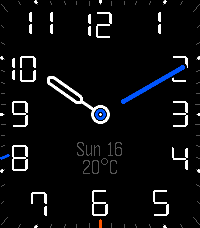

<!-- Generated by scripts/update_app_directory.py: do not edit by hand -->
[← All Pebble Developers](../developers.md)

# jRay

*1 watchface · Last updated 2026-10-11 · [About these lists](../about-app-lists.md)*

Links: [Pebble App Store](https://apps.repebble.com/apps/dev/jray_e8bb00a8353c62f3432d4167) · [GitHub (TheMott27)](https://github.com/TheMott27)

<h2 class="app-name" id="app-4c12b3ada0b540e493ef9d61"><a href="https://apps.repebble.com/4c12b3ada0b540e493ef9d61">Brolly - AWW2 Analogue Weather</a> v3.5.0</h2>
<a class="app-source" href="https://github.com/TheMott27/Brolly-v3" title="Source code" data-search-exclude>View source</a>

Watchface · <a href="https://forum.rebble.io/t/1167" title="Discuss this app on the Rebble forum" data-search-exclude>Forum thread</a>

No licence Released 2026-06-02 Updated 2026-10-06

Runs on: Round 2, Time 2, Pebble 2 Duo, Pebble 2, Time Round, Time, Classic

It&#x27;s a standard classy watchface on first glance with optional date and temperature and minute markers to suit your taste. A smart daily driver that&#x27;s good for the office or on a date. Give your…

