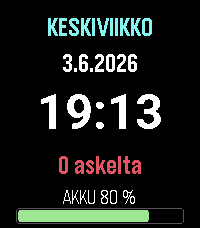

<!-- Generated by scripts/update_app_directory.py: do not edit by hand -->
[← All Pebble Developers](../developers.md)

# jrs8205

*2 watchfaces · Last updated 2026-10-11 · [About these lists](../about-app-lists.md)*

Links: [Pebble App Store](https://apps.repebble.com/apps/dev/jrs8205_dc6f8c24a8fb680254d674d7) · [GitHub (jrs8205)](https://github.com/jrs8205)

<button type="button" data-filter="all" aria-pressed="true">All 2</button><button type="button" data-filter="watchface" aria-pressed="false">Watchfaces 2</button><button type="button" data-filter="watchapp" aria-pressed="false" disabled>Apps 0</button>

<label class="dev-sort">Sort by <select><option value="updated">Recently updated</option><option value="released">Newest release</option><option value="title">A–Z</option></select></label>

<h2 class="app-name" id="app-fdf36c678ce849fb8e0d5650"><a href="https://apps.repebble.com/fdf36c678ce849fb8e0d5650">Aikapaneeli</a> v1.1.0</h2>
<a class="app-source" href="https://github.com/jrs8205/aikapaneeli" title="Source code" data-search-exclude>View source</a>

Watchface

Released 2026-06-03 Updated 2026-06-16

Runs on: Time 2

Aikapaneeli on selkeä, täysin suomenkielinen kellotaulu Pebble Time 2:lle. Yhdellä silmäyksellä näet nämä kaikki: suuri 24 h kello, suomenkielinen viikonpäivä ja päivämäärä, päivän askelmäärä sekä…

<h2 class="app-name" id="app-4ec86198cccb4aea953ee4a2"><a href="https://apps.repebble.com/4ec86198cccb4aea953ee4a2">Time Panel</a> v1.0.0</h2>
<a class="app-source" href="https://github.com/jrs8205/timepanel" title="Source code" data-search-exclude>View source</a>

Watchface

Released 2026-06-08 Updated 2026-06-08

Runs on: Time 2

Time Panel is a clean information watchface for the Pebble Time 2. At a glance it shows everything you need: a large clock that follows your 24h/12h setting (with a small AM/PM indicator in…

