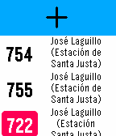

<!-- Generated by scripts/update_app_directory.py: do not edit by hand -->
[← All Pebble Developers](../developers.md)

# Juan Ramón Rodríguez

*1 app · Last updated 2026-10-12 · [About these lists](../about-app-lists.md)*

Links: [Pebble App Store](https://apps.repebble.com/apps/dev/juan-ram-n-rodr-guez_54de19613d38fe91380000a0) · [GitHub (juanrarodriguez18)](https://github.com/juanrarodriguez18)

<h2 class="app-name" id="app-53131440bb31cfb4250001ac"><a href="https://apps.repebble.com/53131440bb31cfb4250001ac">Sevilla Bus</a> v3.0</h2>
<a class="app-source" href="https://github.com/juanrarodriguez18/Sevilla-Bus" title="Source code" data-search-exclude>View source</a>

App

Released 2014-03-02 Updated 2017-09-25

Runs on: Round 2, Time 2, Pebble 2 Duo, Pebble 2, Time Round, Time, Classic

Get realtime service information for Seville buses.

