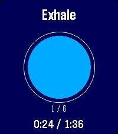
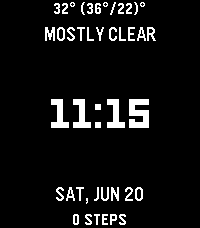

<!-- Generated by scripts/update_app_directory.py: do not edit by hand -->
[← All Pebble Developers](../developers.md)

# julpel8

*3 watchfaces and 1 app · Last updated 2026-10-11 · [About these lists](../about-app-lists.md)*

Links: [Pebble App Store](https://apps.repebble.com/apps/dev/julpel8_4832e5dc5bcac873d9cd9ff7) · [GitHub (julpel8)](https://github.com/julpel8)

<button type="button" data-filter="all" aria-pressed="true">All 4</button><button type="button" data-filter="watchface" aria-pressed="false">Watchfaces 3</button><button type="button" data-filter="watchapp" aria-pressed="false">Apps 1</button>

<label class="dev-sort">Sort by <select><option value="updated">Recently updated</option><option value="released">Newest release</option><option value="title">A–Z</option></select></label>

<h2 class="app-name" id="app-765f2b6ef02b4cb6ac656d2e"><a href="https://apps.repebble.com/765f2b6ef02b4cb6ac656d2e">Earth</a> v0.3.2</h2>
<a class="app-source" href="https://github.com/julpel8/solar-earth" title="Source code" data-search-exclude>View source</a>

Watchface

Released 2026-06-19 Updated 2026-09-03

Runs on: Time 2

A living day/night Earth globe behind the time, with city lights after dark

<h2 class="app-name" id="app-629300609a284e1fab80a763"><a href="https://apps.repebble.com/629300609a284e1fab80a763">Bars 2</a> v0.6.0</h2>
<a class="app-source" href="https://github.com/julpel8/pebble-bars-2" title="Source code" data-search-exclude>View source</a>

Watchface

Released 2026-07-24 Updated 2026-07-26

Runs on: Round 2, Time 2

Because ELEQUENT’s Bars doesn’t work on the Pebble Time 2 and because it’s such a lovely watchface, I decided to recreate it for the new generation of Pebble watches

<h2 class="app-name" id="app-781c85791d034faf952c68ac"><a href="https://apps.repebble.com/781c85791d034faf952c68ac">Breathing</a> v0.0.2</h2>
<a class="app-source" href="https://github.com/julpel8/breathing" title="Source code" data-search-exclude>View source</a>

App

Released 2026-06-30 Updated 2026-06-30

Runs on: Time 2, Pebble 2 Duo

Guided breathing for Pebble: follow an animated circle through inhale/hold/exhale with per-phase vibrations. Choose a rhythm (Box, 4-7-8, Coherent…) and the number of cycles, see the time it…

<h2 class="app-name" id="app-f3eecfb630754c8ab295a1a5"><a href="https://apps.repebble.com/f3eecfb630754c8ab295a1a5">Template</a> v0.0.1</h2>
<a class="app-source" href="https://github.com/julpel8/pebble-watchface-template" title="Source code" data-search-exclude>View source</a>

Watchface

Released 2026-06-20 Updated 2026-06-20

Runs on: Time 2

A minimal, configurable Pebble watchface starter template — time + info lines, weather, night theme, i18n.

