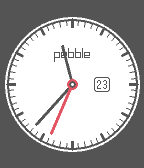
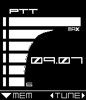

<!-- Generated by scripts/update_app_directory.py: do not edit by hand -->
[← All Pebble Developers](../developers.md)

# Justin Hamilton

*2 watchfaces · Last updated 2026-10-11 · [About these lists](../about-app-lists.md)*

Links: [Pebble App Store](https://apps.repebble.com/apps/dev/justin-hamilton_52b1e952c8363d3367000016) · [GitHub (justinhamilton)](https://github.com/justinhamilton)

<button type="button" data-filter="all" aria-pressed="true">All 2</button><button type="button" data-filter="watchface" aria-pressed="false">Watchfaces 2</button><button type="button" data-filter="watchapp" aria-pressed="false" disabled>Apps 0</button>

<label class="dev-sort">Sort by <select><option value="updated">Recently updated</option><option value="released">Newest release</option><option value="title">A–Z</option></select></label>

<h2 class="app-name" id="app-55613ebafd8f4b535b00001d"><a href="https://apps.repebble.com/55613ebafd8f4b535b00001d">Complications</a> v2.0</h2>
<a class="app-source" href="https://github.com/justinhamilton/complications" title="Source code" data-search-exclude>View source</a>

Watchface

Released 2015-05-24 Updated 2015-08-10

Runs on: Time 2, Time

An analog watchface with 4 slots for customizable complications, so it can be as basic or as complicated as you want. Now includes color customization! Current list of complications: - Seconds…

<h2 class="app-name" id="app-553aeb897fcaa61d4f00006f"><a href="https://apps.repebble.com/553aeb897fcaa61d4f00006f">Codec</a> v1.0</h2>
<a class="app-source" href="https://github.com/justinhamilton/codec" title="Source code" data-search-exclude>View source</a>

Watchface

Released 2015-04-25 Updated 2015-04-25

Runs on: Time 2, Pebble 2 Duo, Pebble 2, Time, Classic

A watchface based off the Codec from Metal Gear Solid. Instead of the frequency, the time is displayed. The bars on the left represent seconds (in increments of 10), &quot;PTT&quot; is your bluetooth…

