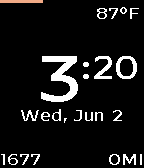

<!-- Generated by scripts/update_app_directory.py: do not edit by hand -->
[← All Pebble Developers](../developers.md)

# Justin Sunseri

*1 watchface · Last updated 2026-10-11 · [About these lists](../about-app-lists.md)*

Links: [Rebble App Store](https://apps.rebble.io/en_US/developer/60b941541342ae00a7b63a91/1) · [GitHub (jmsunseri)](https://github.com/jmsunseri)

<h2 class="app-name" id="app-60b941551342ae00a7b63a93"><a href="https://apps.rebble.io/en_US/application/60b941551342ae00a7b63a93">Pebble Float</a> v1.0</h2>
<a class="app-source" href="https://github.com/jmsunseri/pebble-float" title="Source code" data-search-exclude>View source</a>

Watchface

Released 2021-06-03 Updated 2021-06-03 Rebble App Store

Runs on: Time 2, Pebble 2 Duo, Pebble 2, Time, Classic

Clean watch face displaying time, steps, distance, current temp, date with day of week, and battery bar at the top

