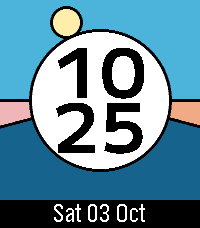
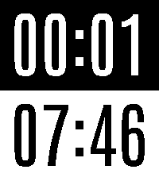
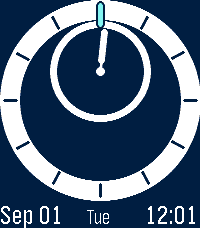
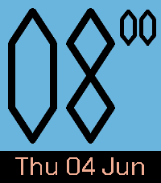
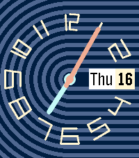
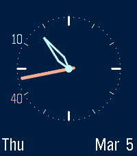
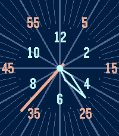

<!-- Generated by scripts/update_app_directory.py: do not edit by hand -->
[← All Pebble Developers](../developers.md)

# justinjhendrick

*12 watchfaces and 2 apps · Last updated 2026-10-12 · [About these lists](../about-app-lists.md)*

Links: [Pebble App Store](https://apps.repebble.com/apps/dev/justinjhendrick_67f68b8a23b7a90009c87db5) · [GitHub (justinjhendrick)](https://github.com/justinjhendrick)

<button type="button" data-filter="all" aria-pressed="true">All 14</button><button type="button" data-filter="watchface" aria-pressed="false">Watchfaces 12</button><button type="button" data-filter="watchapp" aria-pressed="false">Apps 2</button>

<label class="dev-sort">Sort by <select><option value="updated">Recently updated</option><option value="released">Newest release</option><option value="title">A–Z</option></select></label>

<h2 class="app-name" id="app-d3feeca7e927466bb4997abf"><a href="https://apps.repebble.com/d3feeca7e927466bb4997abf">Buzz in X Minutes</a> v1.2.0</h2>
<a class="app-source" href="https://github.com/justinjhendrick/buzz-in-x-minutes" title="Source code" data-search-exclude>View source</a>

App

Released 2026-07-27 Updated 2026-10-10

Runs on: Time 2

A practical minimalist timer for Pebble. It&#x27;s super easy to use! Press up to add 1 minute and down to subtract 1 minute. It automatically starts counting down. When the timer expires, the watch…

<h2 class="app-name" id="app-7a9d24751b8a49319ec1f6e7"><a href="https://apps.repebble.com/7a9d24751b8a49319ec1f6e7">Kingfisher</a> v1.0.0</h2>
<a class="app-source" href="https://github.com/justinjhendrick/pebble-watchface-digilog" title="Source code" data-search-exclude>View source</a>

Watchface

Released 2026-10-03 Updated 2026-10-03

Runs on: Round 2, Time 2

Kingfisher is a colorful digital watchface with the sun moving through the day, night, and twilight arcs. Features: * Great battery life * Uses phone location for sunrise/sunset with a fallback to…

<h2 class="app-name" id="app-151e6e63251a4881a96585de"><a href="https://apps.repebble.com/151e6e63251a4881a96585de">Long Run Stopwatch</a> v1.1.0</h2>
<a class="app-source" href="https://github.com/justinjhendrick/long-run-stopwatch-pebble-app" title="Source code" data-search-exclude>View source</a>

App

Released 2026-08-12 Updated 2026-09-27

Runs on: Time 2

A stopwatch for long runs. Elapsed time on top. Time of day on bottom. Features: * Battery efficient (updates once per minute) * Large text

<h2 class="app-name" id="app-1e1cb157665e42a99335713c"><a href="https://apps.repebble.com/1e1cb157665e42a99335713c">Blue Planet</a> v1.1.0</h2>
<a class="app-source" href="https://github.com/justinjhendrick/blue-planet-pebble-watchface" title="Source code" data-search-exclude>View source</a>

Watchface

Released 2026-09-02 Updated 2026-09-26

Runs on: Round 2, Time 2

Inspired by Bernhard Lederer Universe (BLU) Planet Aventurine Dial

<h2 class="app-name" id="app-67f68f5cc6733d0009b2916d"><a href="https://apps.repebble.com/67f68f5cc6733d0009b2916d">One Minute Hand</a> v1.5.0</h2>
<a class="app-source" href="https://github.com/justinjhendrick/pebble-one-handed-minute/" title="Source code" data-search-exclude>View source</a>

Watchface

Released 2025-04-09 Updated 2026-09-24

Runs on: Round 2, Time 2, Pebble 2 Duo, Pebble 2, Time Round, Time, Classic

A minimalist watchface with a digital hour number and an analog minute hand. Features: * Configurable color scheme * Great battery life (update once per minute) * Support 12h or 24h for hour…

<h2 class="app-name" id="app-cfcf110c62e6483eba7ef85a"><a href="https://apps.repebble.com/cfcf110c62e6483eba7ef85a">Tempilation</a> v1.7.2</h2>
<a class="app-source" href="https://github.com/justinjhendrick/dashboard-pebble-watchface" title="Source code" data-search-exclude>View source</a>

Watchface

Released 2026-04-10 Updated 2026-09-12

Runs on: Time 2

Tempilation is a practical digital watchface with customizable colors and multiple modules to pick from. Designer: SocketMix Programmer: justinjhendrick Inspired by: Samsung Galaxy Basic Dashboard…

<h2 class="app-name" id="app-bf2f17288a0840a5a0308976"><a href="https://apps.repebble.com/bf2f17288a0840a5a0308976">Molniya</a> v1.2.0</h2>
<a class="app-source" href="https://github.com/justinjhendrick/molniya-pebble-watchface/" title="Source code" data-search-exclude>View source</a>

Watchface

Released 2026-07-18 Updated 2026-07-24

Runs on: Round 2, Time 2, Pebble 2 Duo

A minimalist watchface with both digital numbers and analog movement for the minutes. Very large fonts make it easy to read.

<h2 class="app-name" id="app-693625b95434b00008eff112"><a href="https://apps.repebble.com/693625b95434b00008eff112">Varv</a> v2.3.0</h2>
<a class="app-source" href="https://github.com/justinjhendrick/varve-pebble-watchface" title="Source code" data-search-exclude>View source</a>

Watchface · <a href="https://forum.rebble.io/t/164" title="Discuss this app on the Rebble forum" data-search-exclude>Forum thread</a>

Released 2025-12-08 Updated 2026-07-05

Runs on: Time 2, Pebble 2 Duo, Pebble 2, Time, Classic

A Digital watchface with analog time feeling Features: * Huge text for the hour * Minute digits move vertically * Great battery life (updates once per minute) * Font inspired by Super S, optimized…

<h2 class="app-name" id="app-d64decb8397c43e3a3344dc6"><a href="https://apps.repebble.com/d64decb8397c43e3a3344dc6">After Hours</a> v1.0.0</h2>
<a class="app-source" href="https://github.com/justinjhendrick/after-hours-pebble-watchface" title="Source code" data-search-exclude>View source</a>

Watchface · <a href="https://forum.rebble.io/t/1104" title="Discuss this app on the Rebble forum" data-search-exclude>Forum thread</a>

Released 2026-06-29 Updated 2026-06-29

Runs on: Round 2, Time 2, Pebble 2 Duo, Pebble 2, Time Round, Time, Classic

Extreme Battery Saver. Only updates once per hour!

<h2 class="app-name" id="app-680b986073e45d0008e1074b"><a href="https://apps.repebble.com/680b986073e45d0008e1074b">Honey Comb</a> v1.2.0</h2>
<a class="app-source" href="https://github.com/justinjhendrick/honey-comb-pebble-watchface" title="Source code" data-search-exclude>View source</a>

Watchface · <a href="https://forum.rebble.io/t/1092" title="Discuss this app on the Rebble forum" data-search-exclude>Forum thread</a>

Released 2025-04-25 Updated 2026-06-27

Runs on: Round 2, Time 2, Pebble 2 Duo, Pebble 2, Time Round, Time, Classic

A watchface with tessellating hexagons. The top left hexagon shows an analog hour dial. The bottom center hexagon shows a minute dial. The top right hexagon highlights the day of the week. On…

<h2 class="app-name" id="app-68354a1892baf2000a22be0f"><a href="https://apps.repebble.com/68354a1892baf2000a22be0f">Sea Lines</a> v1.9.0</h2>
<a class="app-source" href="https://github.com/justinjhendrick/sea-lines-pebble-watchface" title="Source code" data-search-exclude>View source</a>

Watchface · <a href="https://forum.rebble.io/t/889" title="Discuss this app on the Rebble forum" data-search-exclude>Forum thread</a>

Released 2025-05-27 Updated 2026-06-06

Runs on: Round 2, Time 2, Pebble 2 Duo, Pebble 2, Time Round, Time, Classic

A colorful analog watchface inspired by the Swatch &quot;Trendy Lines At Night&quot;

<h2 class="app-name" id="app-69b73856657baf00098d504e"><a href="https://apps.repebble.com/69b73856657baf00098d504e">Telstar</a> v1.2.0</h2>
<a class="app-source" href="https://github.com/justinjhendrick/alpine_larch_pebble_watchface" title="Source code" data-search-exclude>View source</a>

Watchface · <a href="https://forum.rebble.io/t/775" title="Discuss this app on the Rebble forum" data-search-exclude>Forum thread</a>

Released 2026-03-15 Updated 2026-05-18

Runs on: Round 2, Time 2, Pebble 2 Duo, Pebble 2, Time Round, Time, Classic

A minimalist digital watchface with analog movement for the minutes. The default color scheme is perfect for the Red &amp; Black PT2! Features: * Configurable Colors * Large hour number * Minute…

<h2 class="app-name" id="app-69a3e2aa7998990009c8fa2a"><a href="https://apps.repebble.com/69a3e2aa7998990009c8fa2a">Doug Fir</a> v1.1</h2>
<a class="app-source" href="https://github.com/justinjhendrick/doug_fir_pebble_watchface" title="Source code" data-search-exclude>View source</a>

Watchface · <a href="https://forum.rebble.io/t/724" title="Discuss this app on the Rebble forum" data-search-exclude>Forum thread</a>

Released 2026-03-01 Updated 2026-03-06

Runs on: Round 2, Time 2, Pebble 2 Duo, Pebble 2, Time Round, Time, Classic

Clearly show the time &amp; date. Primarily analog, with digital hints. For color displays, use a different color for hours vs minutes. Avoid overlapping when the hands are near each other by moving…

<h2 class="app-name" id="app-685a4c0465207500093d5a83"><a href="https://apps.repebble.com/685a4c0465207500093d5a83">Double Dial</a> v1.2</h2>
<a class="app-source" href="https://github.com/justinjhendrick/double_tap_pebble_watchface" title="Source code" data-search-exclude>View source</a>

Watchface

Released 2025-06-24 Updated 2025-06-28

Runs on: Round 2, Time 2, Pebble 2 Duo, Pebble 2, Time Round, Time, Classic

Cleverly using color to increase readability of the classic analog watch design. The inner (hour) dial has a consistent color which is distinct from the outer (minute) dial. Half hour ticks and…

