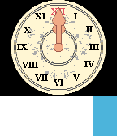

<!-- Generated by scripts/update_app_directory.py: do not edit by hand -->
[← All Pebble Developers](../developers.md)

# jyntran

*3 watchfaces · Last updated 2026-10-12 · [About these lists](../about-app-lists.md)*

Links: [Pebble App Store](https://apps.repebble.com/apps/dev/jyntran_57d0604f4a6ad94b2b0001bd) · [GitHub (jyntran)](https://github.com/jyntran)

<button type="button" data-filter="all" aria-pressed="true">All 3</button><button type="button" data-filter="watchface" aria-pressed="false">Watchfaces 3</button><button type="button" data-filter="watchapp" aria-pressed="false" disabled>Apps 0</button>

<label class="dev-sort">Sort by <select><option value="updated">Recently updated</option><option value="released">Newest release</option><option value="title">A–Z</option></select></label>

<h2 class="app-name" id="app-5816884a46041f64b000026a"><a href="https://apps.repebble.com/5816884a46041f64b000026a">Rokkenjima</a> v2.2</h2>
<a class="app-source" href="https://github.com/jyntran/pebble-rokkenjima" title="Source code" data-search-exclude>View source</a>

Watchface

Released 2016-10-30 Updated 2017-02-17

Runs on: Round 2, Time 2, Pebble 2 Duo, Pebble 2, Time Round, Time, Classic

Analog watchface inspired by the clock from When Seagulls Cry (うみねこのなく頃に, Umineko no Naku Koro Ni). Clay configuration is available: - Background colour - Clock colour - Show/hide clock pattern …

<h2 class="app-name" id="app-5828c7b08c7fff999a00014d"><a href="https://apps.repebble.com/5828c7b08c7fff999a00014d">Brand of Sacrifice</a> v1.1</h2>
<a class="app-source" href="https://github.com/jyntran/pebble-brand-of-sacrifice" title="Source code" data-search-exclude>View source</a>

Watchface

Released 2016-11-13 Updated 2016-11-15

Runs on: Time 2, Pebble 2 Duo, Pebble 2, Time, Classic

Simple digital watchface inspired by Berserk (ベルセルク). Features: - 12/24 hour support - Battery level drawn in the centre of the brand - Brand changes to Bluetooth symbol on disconnect - Timeline…

<h2 class="app-name" id="app-580c456353c08f476c00013c"><a href="https://apps.repebble.com/580c456353c08f476c00013c">Tojo Clan</a> v1.0</h2>
<a class="app-source" href="https://github.com/jyntran/pebble-tojo-clan" title="Source code" data-search-exclude>View source</a>

Watchface

Released 2016-10-23 Updated 2016-10-23

Runs on: Round 2, Time 2, Pebble 2 Duo, Pebble 2, Time Round, Time, Classic

Simple watchface featuring the crest of the Tojo Clan from the Yakuza (龍が如く, Ryu Ga Gotoku) games by Sega. Customization includes: - Background colour - Time font colour - Black or white crest …

