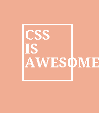

<!-- Generated by scripts/update_app_directory.py: do not edit by hand -->
[← All Pebble Developers](../developers.md)

# Kacper Nitkiewicz

*1 watchface · Last updated 2026-10-12 · [About these lists](../about-app-lists.md)*

Links: [Pebble App Store](https://apps.repebble.com/apps/dev/kacper-nitkiewicz_69de6fa2ad4f08000963c864) · [GitHub (gadzbi123)](https://github.com/gadzbi123)

<h2 class="app-name" id="app-69de70726bba720009a7c065"><a href="https://apps.repebble.com/69de70726bba720009a7c065">CSS is Awesome</a> v1.0</h2>
<a class="app-source" href="https://github.com/gadzbi123/css-is-awesome-pebble-watchface" title="Source code" data-search-exclude>View source</a>

Watchface · <a href="https://forum.rebble.io/t/878" title="Discuss this app on the Rebble forum" data-search-exclude>Forum thread</a>

MIT Released 2026-04-14 Updated 2026-04-14

Runs on: Round 2, Time 2

Embrace a bold, architectural aesthetic with this minimalist watchface. Featuring high-contrast, light-grey sans-serif typography set against a deep, warm bronze background, this face prioritizes…

