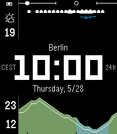

<!-- Generated by scripts/update_app_directory.py: do not edit by hand -->
[← All Pebble Developers](../developers.md)

# Kai Timmer

*1 watchface · Last updated 2026-10-12 · [About these lists](../about-app-lists.md)*

Links: [Pebble App Store](https://apps.repebble.com/apps/dev/kai-timmer_3d43f595fe37bc1757d7ffa7) · [GitHub (kaitimmer)](https://github.com/kaitimmer)

<h2 class="app-name" id="app-d2a90024ac7e4010a1b5b949"><a href="https://apps.repebble.com/d2a90024ac7e4010a1b5b949">DWD Carbon</a> v1.0.1</h2>
<a class="app-source" href="https://github.com/kaitimmer/dwd-carbon" title="Source code" data-search-exclude>View source</a>

Watchface

Released 2026-09-11 Updated 2026-09-11

Runs on: Time 2, Pebble 2 Duo, Pebble 2, Time, Classic

A fork of Carbon, a weather-focused, highly readable-at-a-glance Pebble watchface for the day ahead. This fork defaults to the DWD (Deutscher Wetterdienst) weather source via Bright Sky, best for…

