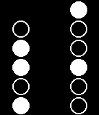

<!-- Generated by scripts/update_app_directory.py: do not edit by hand -->
[← All Pebble Developers](../developers.md)

# kam800

*1 watchface · Last updated 2026-10-11 · [About these lists](../about-app-lists.md)*

Links: [Pebble App Store](https://apps.repebble.com/apps/dev/kam800_52b20434b70e1c9cbc000039) · [GitHub (kam800)](https://github.com/kam800) · [Website (killer-ball.com)](http://killer-ball.com/)

<h2 class="app-name" id="app-52e2d9bdb806fd5675000cb5"><a href="https://apps.repebble.com/52e2d9bdb806fd5675000cb5">Simple Binary</a> v1.0.0</h2>
<a class="app-source" href="https://github.com/kam800/pebble-simple-binary" title="Source code" data-search-exclude>View source</a>

Watchface

Released 2014-01-24 Updated 2014-01-25

Runs on: Time 2, Pebble 2 Duo, Pebble 2, Time, Classic

Energy saving binary clock. It ticks only once per minute to save your battery. Simple Binary displays hours in the left column and minutes in the right column. Based on example Pebble watchface.

