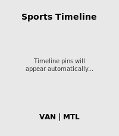

<!-- Generated by scripts/update_app_directory.py: do not edit by hand -->
[← All Pebble Developers](../developers.md)

# KamiShinn

*2 apps · Last updated 2026-10-11 · [About these lists](../about-app-lists.md)*

Links: [Pebble App Store](https://apps.repebble.com/apps/dev/kamishinn_5630f6bc025b51246b000062) · [GitHub (saintyoga-Cyber)](https://github.com/saintyoga-Cyber)

<button type="button" data-filter="all" aria-pressed="true">All 2</button><button type="button" data-filter="watchface" aria-pressed="false" disabled>Watchfaces 0</button><button type="button" data-filter="watchapp" aria-pressed="false">Apps 2</button>

<label class="dev-sort">Sort by <select><option value="updated">Recently updated</option><option value="released">Newest release</option><option value="title">A–Z</option></select></label>

<h2 class="app-name" id="app-695ca015c78a580009d9be0f"><a href="https://apps.repebble.com/695ca015c78a580009d9be0f">Baby Watch app reborn</a> v2.0.0</h2>
<a class="app-source" href="https://github.com/saintyoga-Cyber/Baby-Watch-Reborn" title="Source code" data-search-exclude>View source</a>

App · <a href="https://forum.rebble.io/t/448" title="Discuss this app on the Rebble forum" data-search-exclude>Forum thread</a>

Released 2026-01-06 Updated 2026-06-26

Runs on: Round 2, Time 2, Pebble 2 Duo, Pebble 2, Time Round, Time, Classic

A revival of the Pebby (Baby watch) app - Baby tracking for Pebble smartwatches. Track bottle feedings, diaper changes, and sleep sessions right from your wrist! Each event will also be logged on…

<h2 class="app-name" id="app-6952154891ea9d0009991da2"><a href="https://apps.repebble.com/6952154891ea9d0009991da2">Sports Simplified</a> v2.1.0</h2>
<a class="app-source" href="https://github.com/saintyoga-Cyber/Sports-simplified/tree/main" title="Source code" data-search-exclude>View source</a>

App · <a href="https://forum.rebble.io/t/381" title="Discuss this app on the Rebble forum" data-search-exclude>Forum thread</a>

Released 2025-12-29 Updated 2026-06-12

Runs on: Round 2, Time 2, Pebble 2 Duo, Pebble 2, Time Round, Time, Classic

A simple Pebble watchapp that pushes NHL game timeline pins for the Vancouver Canucks and Montreal Canadiens.

