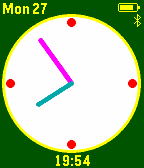

<!-- Generated by scripts/update_app_directory.py: do not edit by hand -->
[← All Pebble Developers](../developers.md)

# kamotswind

*1 watchface · Last updated 2026-10-11 · [About these lists](../about-app-lists.md)*

Links: [Pebble App Store](https://apps.repebble.com/apps/dev/kamotswind_55754e7a315505af78000003) · [GitHub (theforest)](https://github.com/theforest)

<h2 class="app-name" id="app-55948917327b5a1a0d0000a0"><a href="https://apps.repebble.com/55948917327b5a1a0d0000a0">Kamots Time</a> v4.0</h2>
<a class="app-source" href="http://github.com/theforest/Kamots-Time" title="Source code" data-search-exclude>View source</a>

Watchface

Other Released 2015-07-02 Updated 2016-04-03

Runs on: Time 2, Pebble 2 Duo, Pebble 2, Time, Classic

This is a simple low battery utilization watchface with fully customizable colors, battery monitoring and toggle-able Bluetooth status display among other options. Also has a toggle-able weather…

