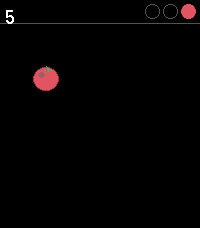
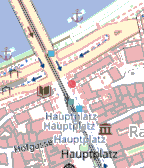
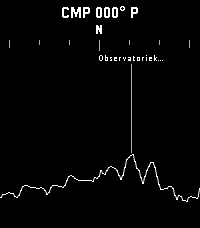

<!-- Generated by scripts/update_app_directory.py: do not edit by hand -->
[← All Pebble Developers](../developers.md)

# Karl

*2 watchfaces and 3 apps · Last updated 2026-10-12 · [About these lists](../about-app-lists.md)*

Links: [Pebble App Store](https://apps.repebble.com/apps/dev/karl_0e91d84045d24bb5497e1700) · [GitHub (KarlKl)](https://github.com/KarlKl)

<button type="button" data-filter="all" aria-pressed="true">All 5</button><button type="button" data-filter="watchface" aria-pressed="false">Watchfaces 2</button><button type="button" data-filter="watchapp" aria-pressed="false">Apps 3</button>

<label class="dev-sort">Sort by <select><option value="updated">Recently updated</option><option value="released">Newest release</option><option value="title">A–Z</option></select></label>

<h2 class="app-name" id="app-358196e1caf34c2688899394"><a href="https://apps.repebble.com/358196e1caf34c2688899394">Tendril</a> v1.0.0</h2>
<a class="app-source" href="https://github.com/KarlKl/Pebble-Tendril" title="Source code" data-search-exclude>View source</a>

Watchface

No licence Released 2026-05-31 Updated 2026-05-31

Runs on: Time 2, Pebble 2 Duo, Pebble 2, Time, Classic

Time is growing on you. Literally. Watch the hours and minutes sprout into shape, branch by branch, leaf by leaf. It&#x27;s a clock. It&#x27;s a forest. It&#x27;s both.

<h2 class="app-name" id="app-880921bc8e06479ba7788cee"><a href="https://apps.repebble.com/880921bc8e06479ba7788cee">Ocean Pulse</a> v1.0.0</h2>
<a class="app-source" href="https://github.com/KarlKl/Pebble-OceanPulse" title="Source code" data-search-exclude>View source</a>

Watchface

No licence Released 2026-05-31 Updated 2026-05-31

Runs on: Round 2, Time 2, Time Round, Time

Your watch. Your beach. Your vibes. Every minute, a wave rolls in from the horizon and washes the old time off the sand — then retreats to reveal the new time, freshly scratched in by some…

<h2 class="app-name" id="app-11c43afc299e4d1d88aea8f4"><a href="https://apps.repebble.com/11c43afc299e4d1d88aea8f4">Slice It!</a> v1.0.0</h2>
<a class="app-source" href="https://github.com/KarlKl/Pebble-SliceIt" title="Source code" data-search-exclude>View source</a>

App

No licence Released 2026-05-18 Updated 2026-05-18

Runs on: Time 2

Slice It! is a fast-paced fruit-slicing game for Pebble Time 2. Swipe across the screen to slice flying fruits and rack up your score. But watch out - black bombs are mixed in, and slicing one…

<h2 class="app-name" id="app-85c73ce43dac489ea6b8908d"><a href="https://apps.repebble.com/85c73ce43dac489ea6b8908d">PebbleTrail Map</a> v1.3</h2>
<a class="app-source" href="https://github.com/KarlKl/PebbleTrail" title="Source code" data-search-exclude>View source</a>

App

No licence Released 2026-03-16 Updated 2026-03-30

Runs on: Round 2, Time 2, Pebble 2 Duo, Pebble 2, Time Round, Time, Classic

PebbleTrail Map: Your Adventure Companion Explore the outdoors with confidence using PebbleTrail Map, the ultimate GPS and map app for your Pebble smartwatch. Track your real-time location, load…

<h2 class="app-name" id="app-b255f708d396497fa1af400f"><a href="https://apps.repebble.com/b255f708d396497fa1af400f">Horizon Scout</a> v1.0</h2>
<a class="app-source" href="https://github.com/KarlKl/HorizonScout" title="Source code" data-search-exclude>View source</a>

App

No licence Released 2026-03-29 Updated 2026-03-29

Runs on: Round 2, Time 2, Pebble 2 Duo, Pebble 2, Time Round, Time, Classic

Explore the world around you with Horizon Scout, an app that identifies mountains and peaks in your view based on your location and direction. Perfect for hikers, outdoor enthusiasts, and anyone…

