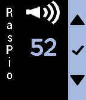
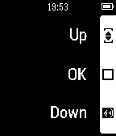

<!-- Generated by scripts/update_app_directory.py: do not edit by hand -->
[← All Pebble Developers](../developers.md)

# KaRo

*1 watchface and 2 apps · Last updated 2026-10-12 · [About these lists](../about-app-lists.md)*

Links: [Pebble App Store](https://apps.repebble.com/apps/dev/karo_54da388a5f4f24af68000090) · [GitHub (Roemke)](https://github.com/Roemke)

<button type="button" data-filter="all" aria-pressed="true">All 3</button><button type="button" data-filter="watchface" aria-pressed="false">Watchfaces 1</button><button type="button" data-filter="watchapp" aria-pressed="false">Apps 2</button>

<label class="dev-sort">Sort by <select><option value="updated">Recently updated</option><option value="released">Newest release</option><option value="title">A–Z</option></select></label>

<h2 class="app-name" id="app-56f978253c131b455b000009"><a href="https://apps.repebble.com/56f978253c131b455b000009">raspio</a> v1.2</h2>
<a class="app-source" href="https://github.com/Roemke/pebbleraspio" title="Source code" data-search-exclude>View source</a>

App

MIT Released 2016-03-28 Updated 2016-04-01

Runs on: Time 2, Pebble 2 Duo, Pebble 2, Time, Classic

Control Vu+ Solo satelite receiver and Raspberry Pi Internetradio. See Github for more information (link to source code) Satellitenreceiver Vu+Solo und Internetradio steuern. Weitere Informationen…

<h2 class="app-name" id="app-54e9b12d0f0bb317e900004b"><a href="https://apps.repebble.com/54e9b12d0f0bb317e900004b">Fuzzy TT Edition</a> v1.8</h2>
<a class="app-source" href="https://github.com/Roemke/Fuzzy-Text-International" title="Source code" data-search-exclude>View source</a>

Watchface

No licence Released 2015-02-22 Updated 2016-01-02

Runs on: Time 2, Pebble 2 Duo, Pebble 2, Time, Classic

Fuzzy Time based on Fuzzy Text International with timetable extension. Shows battery status. Shows battery status of phone (Android 6, maybe 5, otherwise you need a small server on your phone…

<h2 class="app-name" id="app-5515c946038760763b00002d"><a href="https://apps.repebble.com/5515c946038760763b00002d">EnigmaVu</a> v1.2</h2>
<a class="app-source" href="https://github.com/Roemke/enigmavu" title="Source code" data-search-exclude>View source</a>

App

MIT Released 2015-03-27 Updated 2015-05-04

Runs on: Time 2, Pebble 2 Duo, Pebble 2, Time, Classic

Remote Control for Dreambox(?) / Enigma based satellite receiver. Tested on Vu+ Solo2. You can control Power, Volume and Program by the buttons of your watch. I will left this app as it is because…

