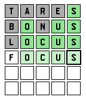
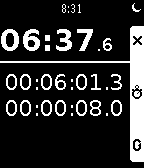

<!-- Generated by scripts/update_app_directory.py: do not edit by hand -->
[← All Pebble Developers](../developers.md)

# Katharine Berry

*3 apps · Last updated 2026-10-11 · [About these lists](../about-app-lists.md)*

Links: [Rebble App Store](https://apps.rebble.io/en_US/developer/52b6e8a9f21b2c24ef000014/1) · [Pebble App Store](https://apps.repebble.com/apps/dev/katharine-berry_52b6e8a9f21b2c24ef000014) · [GitHub (Katharine)](https://github.com/Katharine) · [Website (kathar.in)](https://kathar.in)

<button type="button" data-filter="all" aria-pressed="true">All 3</button><button type="button" data-filter="watchface" aria-pressed="false" disabled>Watchfaces 0</button><button type="button" data-filter="watchapp" aria-pressed="false">Apps 3</button>

<label class="dev-sort">Sort by <select><option value="updated">Recently updated</option><option value="released">Newest release</option><option value="title">A–Z</option></select></label>

<h2 class="app-name" id="app-62304a7d2a976b000a6e73df"><a href="https://apps.rebble.io/en_US/application/62304a7d2a976b000a6e73df">Pebble Wordle</a> v1.3</h2>
<a class="app-source" href="https://github.com/Katharine/pebble-wordle" title="Source code" data-search-exclude>View source</a>

App

MIT Released 2022-03-15 Updated 2022-05-27 Rebble App Store

Runs on: Time 2, Pebble 2 Duo, Pebble 2, Time, Classic

Full featured Wordle on your Pebble! - Uses the same word each day as the New York Times&#x27; Wordle! - Saves your work when you leave the app. - Tracks your gameplay stats - streak, guess…

<h2 class="app-name" id="app-53eb5caf6743f7a863000201"><a href="https://apps.repebble.com/53eb5caf6743f7a863000201">Caltrain</a> v1.10</h2>
<a class="app-source" href="https://github.com/Katharine/pebble-caltrain" title="Source code" data-search-exclude>View source</a>

App

MIT Released 2014-08-13 Updated 2017-06-17

Runs on: Round 2, Time 2, Pebble 2 Duo, Pebble 2, Time Round, Time, Classic

Shows the next trains to any given Caltrain stop. No phone or internet required; the schedule is stored locally. If a phone is connected, will automatically open the nearest station; otherwise…

<h2 class="app-name" id="app-52b6e9f65dd7573050000011"><a href="https://apps.repebble.com/52b6e9f65dd7573050000011">Stopwatch</a> v2.0</h2>
<a class="app-source" href="http://github.com/Katharine/pebble-stopwatch" title="Source code" data-search-exclude>View source</a>

App

No licence Released 2013-12-22 Updated 2013-12-22

Runs on: Time 2, Pebble 2 Duo, Pebble 2, Time, Classic

Stopwatch with thirty lap history.

