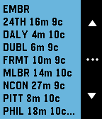

<!-- Generated by scripts/update_app_directory.py: do not edit by hand -->
[← All Pebble Developers](../developers.md)

# Kaushik Ashodiya

*1 app · Last updated 2026-10-11 · [About these lists](../about-app-lists.md)*

Links: [Pebble App Store](https://apps.repebble.com/apps/dev/kaushik-ashodiya_56c1ef15919c5a4dc800000b) · [GitHub (kashodiya)](https://github.com/kashodiya)

<h2 class="app-name" id="app-56ce4a6c86ce3b1bb3000058"><a href="https://apps.repebble.com/56ce4a6c86ce3b1bb3000058">Barty</a> v1.1</h2>
<a class="app-source" href="https://github.com/kashodiya/barty" title="Source code" data-search-exclude>View source</a>

App

Released 2016-02-25 Updated 2016-02-25

Runs on: Round 2, Time 2, Pebble 2 Duo, Pebble 2, Time Round, Time, Classic

Get realtime BART arrivals.

