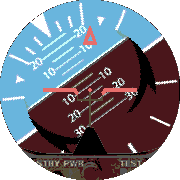

<!-- Generated by scripts/update_app_directory.py: do not edit by hand -->
[← All Pebble Developers](../developers.md)

# KCK

*1 watchface · Last updated 2026-10-12 · [About these lists](../about-app-lists.md)*

Links: [Pebble App Store](https://apps.repebble.com/apps/dev/kck_57422e52bf249269f6000010) · [GitHub (mknarciso)](https://github.com/mknarciso)

<h2 class="app-name" id="app-57c2e7955e3c3de160000300"><a href="https://apps.repebble.com/57c2e7955e3c3de160000300">Pilot - Attitude Indicator</a> v1.1</h2>
<a class="app-source" href="https://github.com/mknarciso/PebbleWatchFace-Pilot" title="Source code" data-search-exclude>View source</a>

Watchface

Released 2016-08-28 Updated 2016-08-29

Runs on: Round 2, Time Round

Attitude Indicator (Artificial Horizon) Watchface The ROLL indicates the hour in 12 hour format. The PITCH indicates the minutes: From 0 to 30 min: Pitch-up! From 31 to 59 min: Pitch-down! (and…

