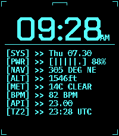

<!-- Generated by scripts/update_app_directory.py: do not edit by hand -->
[← All Pebble Developers](../developers.md)

# Keatr0n

*1 watchface and 2 apps · Last updated 2026-10-12 · [About these lists](../about-app-lists.md)*

Links: [Pebble App Store](https://apps.repebble.com/apps/dev/keatr0n_2a36dcefb2ef947e811561d5) · [GitHub (Keatr0n)](https://github.com/Keatr0n)

<button type="button" data-filter="all" aria-pressed="true">All 3</button><button type="button" data-filter="watchface" aria-pressed="false">Watchfaces 1</button><button type="button" data-filter="watchapp" aria-pressed="false">Apps 2</button>

<label class="dev-sort">Sort by <select><option value="updated">Recently updated</option><option value="released">Newest release</option><option value="title">A–Z</option></select></label>

<h2 class="app-name" id="app-5e0010ad98264c2cb90174d5"><a href="https://apps.repebble.com/5e0010ad98264c2cb90174d5">Nav Aid</a> v1.0.3</h2>
<a class="app-source" href="https://github.com/Keatr0n/pebble_nav_aid" title="Source code" data-search-exclude>View source</a>

App

No licence Released 2026-09-17 Updated 2026-10-04

Runs on: Round 2, Time 2, Pebble 2 Duo

Nav Aid is designed to be a glanceable supplemental information system for navigation and situational awareness in the air. Mostly for GA pilots, but useful for anyone operating in the air…

<h2 class="app-name" id="app-648bfbf405594a0b99b99445"><a href="https://apps.repebble.com/648bfbf405594a0b99b99445">pebble_deck</a> v1.2.0</h2>
<a class="app-source" href="https://github.com/Keatr0n/pebble_deck" title="Source code" data-search-exclude>View source</a>

Watchface · <a href="https://forum.rebble.io/t/1193" title="Discuss this app on the Rebble forum" data-search-exclude>Forum thread</a>

No licence Released 2026-07-28 Updated 2026-09-03

Runs on: Time 2

pebble_deck is designed to emulate a terminal interface with 8 customizable complication slots. You can pick from any of the following: - Date - Battery - Free heap memory - Compass (only updates…

<h2 class="app-name" id="app-e4f125087c884a95abc3dcd7"><a href="https://apps.repebble.com/e4f125087c884a95abc3dcd7">AI Girlfriend</a> v1.1.0</h2>
<a class="app-source" href="https://github.com/Keatr0n/ai_girlfriend_pebble" title="Source code" data-search-exclude>View source</a>

App

No licence Released 2026-08-06 Updated 2026-08-07

Runs on: Round 2, Time 2, Pebble 2 Duo

You need a fast and easy way to talk to your favourite ai assistant? Look no further than AI Girlfriend. As soon as the app is launched it starts dictation so you can immediately start chatting…

