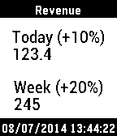

<!-- Generated by scripts/update_app_directory.py: do not edit by hand -->
[← All Pebble Developers](../developers.md)

# Keboola

*1 app · Last updated 2026-10-12 · [About these lists](../about-app-lists.md)*

Links: [Pebble App Store](https://apps.repebble.com/apps/dev/keboola_539fec2b310ad71d32000151) · [GitHub (keboola)](https://github.com/keboola) · [Website (keboola.com)](http://www.keboola.com)

<h2 class="app-name" id="app-53bbd8c7c22300d74600018a"><a href="https://apps.repebble.com/53bbd8c7c22300d74600018a">Keboola Stats</a> v1.5</h2>
<a class="app-source" href="https://github.com/keboola/pebble-watchapp" title="Source code" data-search-exclude>View source</a>

App

Released 2014-07-08 Updated 2014-08-22

Runs on: Time 2, Pebble 2 Duo, Pebble 2, Time, Classic

The most important BI metric at your fingertips (literally). “Keboola Stats” connects with your data to deliver business insights on the go. Whether it&#x27;s a report on GoodData.com or just data…

