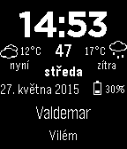

<!-- Generated by scripts/update_app_directory.py: do not edit by hand -->
[← All Pebble Developers](../developers.md)

# kecinzer

*2 watchfaces · Last updated 2026-10-12 · [About these lists](../about-app-lists.md)*

Links: [Pebble App Store](https://apps.repebble.com/apps/dev/kecinzer_5551d20eec8de7dbd300000b) · [GitHub (kecinzer)](https://github.com/kecinzer)

<button type="button" data-filter="all" aria-pressed="true">All 2</button><button type="button" data-filter="watchface" aria-pressed="false">Watchfaces 2</button><button type="button" data-filter="watchapp" aria-pressed="false" disabled>Apps 0</button>

<label class="dev-sort">Sort by <select><option value="updated">Recently updated</option><option value="released">Newest release</option><option value="title">A–Z</option></select></label>

<h2 class="app-name" id="app-555dc1f84c2222d9ec00009d"><a href="https://apps.repebble.com/555dc1f84c2222d9ec00009d">czDigiWatch</a> v1.7</h2>
<a class="app-source" href="https://github.com/kecinzer/czDigiWatch" title="Source code" data-search-exclude>View source</a>

Watchface

Released 2015-05-21 Updated 2015-05-28

Runs on: Time 2, Pebble 2 Duo, Pebble 2, Time, Classic

Now supports - Czech. This watchface provides time (including seconds), date and day of the week in digital form. And also namedays for current and next day. If namedays is public holiday, it&#x27;s…

<h2 class="app-name" id="app-555dbd964c22228b5e0000c5"><a href="https://apps.repebble.com/555dbd964c22228b5e0000c5">czTxtWatch</a> v1.2</h2>
<a class="app-source" href="https://github.com/kecinzer/czTxtWatch" title="Source code" data-search-exclude>View source</a>

Watchface

Released 2015-05-21 Updated 2015-05-22

Runs on: Time 2, Pebble 2 Duo, Pebble 2, Time, Classic

Now supports - Czech. This watchface provides time, date and day of the week in textual form. And also current nameday. If nameday is public holiday, it&#x27;s rendered as bold. It&#x27;s only for czech…

