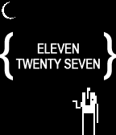

<!-- Generated by scripts/update_app_directory.py: do not edit by hand -->
[← All Pebble Developers](../developers.md)

# Keelan C

*3 watchfaces · Last updated 2026-10-12 · [About these lists](../about-app-lists.md)*

Links: [Pebble App Store](https://apps.repebble.com/apps/dev/keelan-c_529eb0fc1a66380531000038) · [GitHub (keelanc)](https://github.com/keelanc)

<button type="button" data-filter="all" aria-pressed="true">All 3</button><button type="button" data-filter="watchface" aria-pressed="false">Watchfaces 3</button><button type="button" data-filter="watchapp" aria-pressed="false" disabled>Apps 0</button>

<label class="dev-sort">Sort by <select><option value="updated">Recently updated</option><option value="released">Newest release</option><option value="title">A–Z</option></select></label>

<h2 class="app-name" id="app-52bf33276ecafe7e4c000094"><a href="https://apps.repebble.com/52bf33276ecafe7e4c000094">Text Watch 2</a> v1.1.0</h2>
<a class="app-source" href="https://github.com/keelanc/text_watch_2" title="Source code" data-search-exclude>View source</a>

Watchface

Released 2013-12-28 Updated 2014-02-05

Runs on: Time 2, Pebble 2 Duo, Pebble 2, Time, Classic

A &#x27;better&#x27; version of the default &#x27;Text Watch&#x27; watchface by Pebble Tech. Tap/shake the watch for date and weather info. Choose °C or °F from the mobile app. Added ‘o’ prefix for single-digit…

<h2 class="app-name" id="app-52b37160b06f4ba1dd00000a"><a href="https://apps.repebble.com/52b37160b06f4ba1dd00000a">Sworcery</a> v1.1.2</h2>
<a class="app-source" href="https://github.com/keelanc/sworcery" title="Source code" data-search-exclude>View source</a>

Watchface

Released 2013-12-19 Updated 2014-01-24

Runs on: Time 2, Pebble 2 Duo, Pebble 2, Time, Classic

An animated watchface based on the excellent game &#x27;Sword &amp; Sworcery&#x27; by Superbrothers and Capybara Games. There are a few animations: on app launch, every 15 seconds, on the minute change, and…

<h2 class="app-name" id="app-529ebd1ed7894b5946000028"><a href="https://apps.repebble.com/529ebd1ed7894b5946000028">Hobbit Time</a> v1.0.3</h2>
<a class="app-source" href="https://github.com/keelanc/hobbit_time" title="Source code" data-search-exclude>View source</a>

Watchface

Released 2013-12-04 Updated 2014-01-24

Runs on: Time 2, Pebble 2 Duo, Pebble 2, Time, Classic

I&#x27;d like to think hobbits tell time by the grumbling in their tummies. Starting at 5am (and &#x27;sleep&#x27; otherwise): almost breakfast, breakfast, seven-ish, almost second breakfast, second breakfast…

