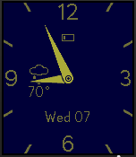

<!-- Generated by scripts/update_app_directory.py: do not edit by hand -->
[← All Pebble Developers](../developers.md)

# Keith Harp

*1 watchface · Last updated 2026-10-12 · [About these lists](../about-app-lists.md)*

Links: [Pebble App Store](https://apps.repebble.com/apps/dev/keith-harp_55eb897a4d076da332000083) · [GitHub (keithharp)](https://github.com/keithharp)

<h2 class="app-name" id="app-57ad24eaf01b53532400019b"><a href="https://apps.repebble.com/57ad24eaf01b53532400019b">Minimal Analog 2</a> v1.5</h2>
<a class="app-source" href="https://github.com/keithharp/minimalanalog" title="Source code" data-search-exclude>View source</a>

Watchface

Released 2016-08-12 Updated 2016-09-07

Runs on: Round 2, Time 2, Pebble 2 Duo, Pebble 2, Time Round, Time, Classic

A simple analog watchface that includes - weather (Yahoo or OpenWeather), - bluetooth disconnect notification (optional) - seconds hand (always on, always off, or able to toggle with a tap) - low…

