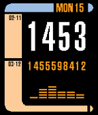

<!-- Generated by scripts/update_app_directory.py: do not edit by hand -->
[← All Pebble Developers](../developers.md)

# keithzg

*3 watchfaces · Last updated 2026-10-12 · [About these lists](../about-app-lists.md)*

Links: [Pebble App Store](https://apps.repebble.com/apps/dev/keithzg_52d9c139b82a9f04f2000024) · [GitHub (keithzg)](https://github.com/keithzg)

<button type="button" data-filter="all" aria-pressed="true">All 3</button><button type="button" data-filter="watchface" aria-pressed="false">Watchfaces 3</button><button type="button" data-filter="watchapp" aria-pressed="false" disabled>Apps 0</button>

<label class="dev-sort">Sort by <select><option value="updated">Recently updated</option><option value="released">Newest release</option><option value="title">A–Z</option></select></label>

<h2 class="app-name" id="app-56bedba7f65c491cd4000068"><a href="https://apps.repebble.com/56bedba7f65c491cd4000068">LCARS v3 Colored</a> v3.1</h2>
<a class="app-source" href="https://github.com/keithzg/LCARS-1-SDK-3.0-colored" title="Source code" data-search-exclude>View source</a>

Watchface

Released 2016-02-13 Updated 2016-02-15

Runs on: Time 2, Time

LCARS watchface, updated for Time with some colors

<h2 class="app-name" id="app-56c26237b710f6e1da000013"><a href="https://apps.repebble.com/56c26237b710f6e1da000013">Concentricity-24hr</a> v1.1</h2>
<a class="app-source" href="https://github.com/keithzg/concentricity" title="Source code" data-search-exclude>View source</a>

Watchface

Released 2016-02-15 Updated 2016-02-15

Runs on: Round 2, Time 2, Pebble 2 Duo, Pebble 2, Time Round, Time, Classic

Concentricity watchface from https://github.com/pebble-examples/concentricity, modified to use a 24-hour cycle rather than a 12-hour cycle.

<h2 class="app-name" id="app-541768c2d8eb58ee1a000003"><a href="https://apps.repebble.com/541768c2d8eb58ee1a000003">Fuzzier Fuzzy Text International</a> v1.3</h2>
<a class="app-source" href="https://github.com/keithzg/Fuzzier-Fuzzy-Text-International" title="Source code" data-search-exclude>View source</a>

Watchface

Released 2014-09-15 Updated 2014-09-15

Runs on: Time 2, Pebble 2 Duo, Pebble 2, Time, Classic

A dirty hack of Fuzzy Text International for folks like myself who felt all of the existing &quot;fuzzy&quot; watchfaces were still too specific. If you want to wake up and have your watch tell you it&#x27;s…

