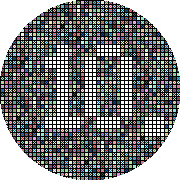
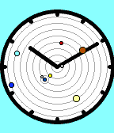

<!-- Generated by scripts/update_app_directory.py: do not edit by hand -->
[← All Pebble Developers](../developers.md)

# Kelby

*2 watchfaces and 1 app · Last updated 2026-10-12 · [About these lists](../about-app-lists.md)*

Links: [Pebble App Store](https://apps.repebble.com/apps/dev/kelby_55b13e5fd53410746c000090) · [GitHub (tripleplay369)](https://github.com/tripleplay369)

<button type="button" data-filter="all" aria-pressed="true">All 3</button><button type="button" data-filter="watchface" aria-pressed="false">Watchfaces 2</button><button type="button" data-filter="watchapp" aria-pressed="false">Apps 1</button>

<label class="dev-sort">Sort by <select><option value="updated">Recently updated</option><option value="released">Newest release</option><option value="title">A–Z</option></select></label>

<h2 class="app-name" id="app-56b175d810121e0f58000003"><a href="https://apps.repebble.com/56b175d810121e0f58000003">Disco</a> v1.01</h2>
<a class="app-source" href="https://github.com/tripleplay369/pebble-disco" title="Source code" data-search-exclude>View source</a>

Watchface

Released 2016-02-03 Updated 2016-02-03

Runs on: Round 2, Time Round

Hybrid digital/analog watchface designed specifically for the Pebble Time Round. Let the beautiful patterns of rand() take you to another dimension.

<h2 class="app-name" id="app-55da378a6323c5cc54000029"><a href="https://apps.repebble.com/55da378a6323c5cc54000029">Color Calendar</a> v2.0</h2>
<a class="app-source" href="https://github.com/tripleplay369/pebble-color-calendar" title="Source code" data-search-exclude>View source</a>

App

Released 2015-08-23 Updated 2016-01-04

Runs on: Round 2, Time 2, Time Round, Time

A simple, easy to read calendar designed specifically for the Pebble Time. Up and down buttons scroll between months, select button returns to today. Long select button press toggles between…

<h2 class="app-name" id="app-55bd604da5c6f3772200008c"><a href="https://apps.repebble.com/55bd604da5c6f3772200008c">Ambient</a> v1.07</h2>
<a class="app-source" href="https://github.com/tripleplay369/PebbleAmbient" title="Source code" data-search-exclude>View source</a>

Watchface

Released 2015-08-02 Updated 2015-08-10

Runs on: Time 2, Time

Simple analog watchface that includes the location of the 8 planets, and the moon (sorry Pluto, no room). Background color gradually changes from black to light blue based on the time of day.

