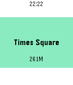

<!-- Generated by scripts/update_app_directory.py: do not edit by hand -->
[← All Pebble Developers](../developers.md)

# Kenji Abe

*1 app · Last updated 2026-10-12 · [About these lists](../about-app-lists.md)*

Links: [Pebble App Store](https://apps.repebble.com/apps/dev/kenji-abe_56ee4caf11c02b65d8000038) · [GitHub (STAR-ZERO)](https://github.com/STAR-ZERO)

<h2 class="app-name" id="app-570e3c223add23d9cc00001b"><a href="https://apps.repebble.com/570e3c223add23d9cc00001b">Switt</a> v1.0</h2>
<a class="app-source" href="https://github.com/STAR-ZERO/switt" title="Source code" data-search-exclude>View source</a>

App

No licence Released 2016-04-13 Updated 2016-04-14

Runs on: Round 2, Time 2, Pebble 2 Duo, Pebble 2, Time Round, Time, Classic

Simple Swarm (Foursquare) client which can post to Twitter. You can post to twitter when you check-in.

